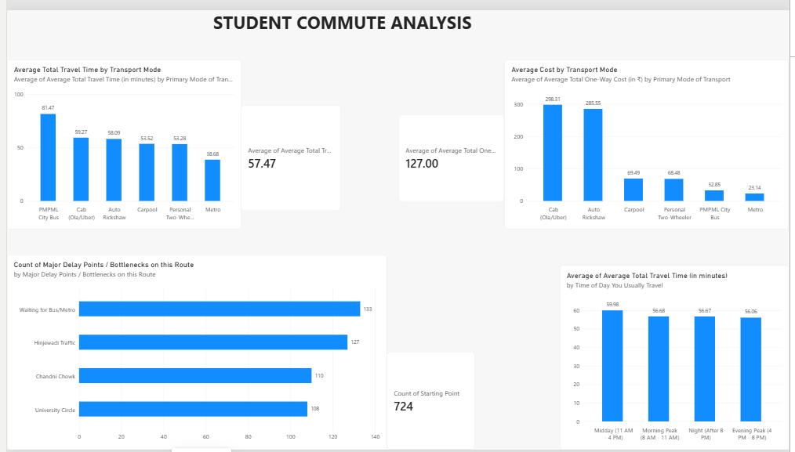

Student Commute Analysis

Project Overview

This project analyzes student commute data to understand travel time, transportation costs, transport modes, and common commute bottlenecks.

## Dashboard Preview

Objectives

- Compare average travel time across transport modes.
- Analyze average one-way transportation costs.
- Identify frequently reported commute bottlenecks.
- Compare travel time across different times of day.
- Present findings using Python and Power BI.

Dataset

- Records: 724
- Columns: 10
- Tools: Python, Pandas, Power BI

Tools and Technologies

- Python
- Pandas
- Google Colab
- Microsoft Power BI

Key Findings

- Metro: Lowest average travel time, approximately 38.68 minutes.
- PMPML City Bus: Highest average travel time, approximately 81.47 minutes.
- Metro: Lowest average one-way cost, approximately ₹23.14.
- Cab: Highest average one-way cost, approximately ₹298.31.
- Waiting for Bus/Metro: Most frequently reported bottleneck, with 133 reports.

Project Outputs

- Python notebook for data analysis.
- Power BI dashboard with KPI cards and charts.
- A separate page presenting insights and findings.

Conclusion

This project demonstrates data exploration, aggregation, comparison, and visualization to summarize student commuting patterns.

These findings describe the collected responses and do not establish cause and effect.
